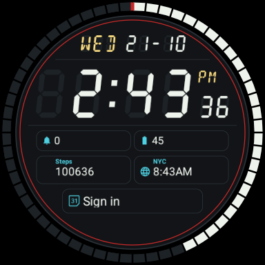
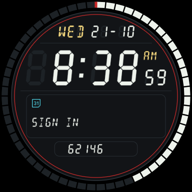
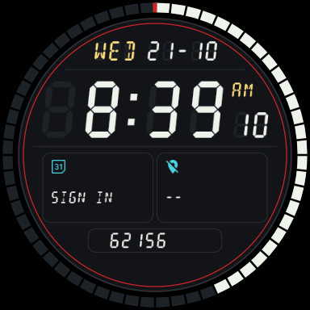
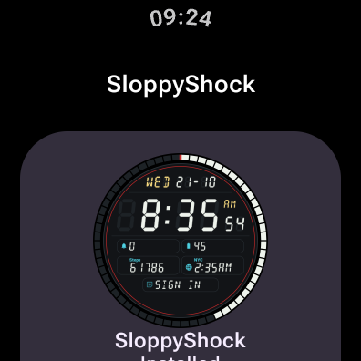

# SloppyShock

> **This project is AI-assisted.** Most of the code, the watch faces and this
> documentation were written with Claude (Anthropic) under human direction and
> tested on real hardware.

Negative-LCD digital watch faces for Wear OS: segment-display digits with unlit
"ghost" segments, a 60-segment ring and lots of complications. Written in
[Watch Face Format](https://developer.android.com/training/wearables/wff), no
code in the faces.

| SloppyShock | SloppyShock Detailed | SloppyShock Dual |
|:---:|:---:|:---:|
|  |  |  |
| five small complications | one large detail panel | two detail panels |

All three have day/date, time with AM/PM and seconds, a ring that shows a
complication (battery by default) or the seconds, invisible tap areas on the
time and date that open an app of your choice, and a low-power always-on mode.

The faces are installed by the **SloppyShock app** on the watch, which carries
all three and switches between them (Wear OS 6
[Watch Face Push](https://developer.android.com/training/wearables/watch-face-push)):



**Tested on a Samsung Galaxy Watch4 Classic** (Wear OS 6). It should also work
on other round Wear OS 6 watches; square screens are not supported.

## Install on your watch

Each release has two kinds of APK; pick one:

| File | What it is | Needs |
|---|---|---|
| `SloppyShock-App-<version>.apk` | the SloppyShock app with all three faces; switch layouts in the app | Wear OS 6 |
| `SloppyShock-Face-<Layout>-<version>.apk` | a single face (`Compact`, `Detailed` or `Dual`), nothing else | Wear OS 5 or newer |

Use the app **or** the single faces for a layout, not both: a single face and
the face the app installs share the same package, so uninstall a single face
before using that layout from the app (and vice versa).

APKs can't be installed on a watch by tapping them, so they go over the
watch's wireless debugging, either from your phone or from a PC.

**1. Enable wireless debugging on the watch (once)**

1. Settings → About watch → Software information → tap **Software version**
   (Galaxy) or **Build number** (other watches) about 7 times until developer
   options are enabled.
2. Settings → Developer options → enable **ADB debugging** and
   **Wireless debugging** (watch and phone/PC must be on the same Wi-Fi).

**2a. Install from your phone with Wear Installer 2 (no PC)**

1. Install [Wear Installer 2](https://play.google.com/store/search?q=Wear%20Installer%202&c=apps)
   from Google Play on your phone and download the APK(s) to the phone.
2. On the watch open Wireless debugging → **Pair new device**; enter the shown
   IP address, port and pairing code in Wear Installer 2 (its built-in help
   video walks through this).
3. Choose the downloaded APK in Wear Installer 2 and install it (repeat for
   each single face you want).

**2b. Or install from a PC with adb**

```bash
adb pair <watch-ip>:<pairing-port>        # IP, port and code from "Pair new device"
```

```bash
adb connect <watch-ip>:<port>             # port shown on the Wireless debugging screen
```

```bash
adb install SloppyShock-App-<version>.apk      # or SloppyShock-Face-Dual-<version>.apk, …
```

**3. Use it**

- **Single face:** long-press the watch face and pick it from the list.
- **App:** installing the app also installs the **SloppyShock** face. Long-press the
  watch face and pick it, or open the **SloppyShock** app and tap **Use**.
- Switch layouts in the app (Wear OS allows one face per app, so **Use**
  replaces the current SloppyShock face). Switching resets that face's
  complication choices; app updates keep them. Allow the "watch face" permission
  when asked so the app can activate faces itself.
- Customize as usual: long-press the face → edit. **Ring** chooses complication
  or seconds; the complications page has all slots plus **Tap on time** /
  **Tap on date** (pick any app shortcut).
- You can turn wireless debugging off again afterwards.

## Building

Requirements: Android SDK with platform 37 (`local.properties` → `sdk.dir`),
JDK 25 (Gradle toolchain; wrapper included), Python 3 with `fontTools` and
`Pillow` (only to regenerate sources).

```bash
./gradlew distDebug              # build/dist/debug: SloppyShock-App-dev.apk + SloppyShock-Face-*-dev.apk
./gradlew :app:installDebug      # install the app (ANDROID_SERIAL=<watch> with several devices)
```

The build validates every face with Google's Watch Face Push validator and
bundles it with its validation token; a face that fails validation fails the
build.

On devices without Watch Face Push (Wear OS 5, e.g. the emulator) install the
faces directly instead: `./gradlew :watchface:installAllFaces`.

Release builds need signing keys from environment variables: `SIGNING_*` for
the app and `FACE_SIGNING_*` for the faces (Watch Face Push requires a separate
key for faces), each with `_KEYSTORE`, `_STORE_PASSWORD`, `_KEY_ALIAS`,
`_KEY_PASSWORD`. `./gradlew distRelease -PversionName=X` collects the signed
APKs in `build/dist/release`. Tagging `v*` on GitHub runs
`.github/workflows/release.yml`, which publishes the app and all single-face
APKs.

## Project structure

```
tools/
  gen_watchface.py       # generates every face's watchface.xml + strings.xml
  gen_segment_font.py    # generates the segment font and always-on digit PNGs
watchface/               # the faces: flavors compact/detailed/dual, one APK each
  build.gradle.kts       # validation tasks (validate<Face><Type>), installAllFaces
  src/main/              # shared: manifest, watch_face_info, font, digit PNGs (generated)
  src/<flavor>/res/      # raw/watchface.xml + values/strings.xml (generated), preview.png
app/                     # the SloppyShock watch app (Kotlin, Wear Compose)
  build.gradle.kts       # bundles the validated faces into assets
  src/main/java/…/Faces.kt          # Watch Face Push: list, install/switch, remove
  src/main/java/…/MainActivity.kt   # UI
```

## Editing the faces

The face XML is generated; edit the Python generators, never the XML:

```bash
python3 tools/gen_segment_font.py   # after changing glyphs, digit size or colour
python3 tools/gen_watchface.py      # after any layout/behaviour change
```

Useful knobs in `tools/gen_watchface.py`: palette (`LCD`, `ACCENT`, `AOD_*`),
`PANEL_R` (panel size; the layout scales with it), `SLOTS_COMPACT` /
`SLOTS_DETAILED` / `SLOTS_DUAL` (slot positions and default providers),
`TAP_AREAS`, `RING_MODES`. A face may have at most 8 complication slots.

## License

[The Unlicense](LICENSE): public domain, do whatever you want.
